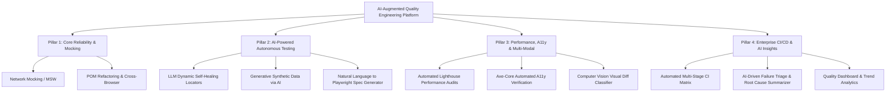
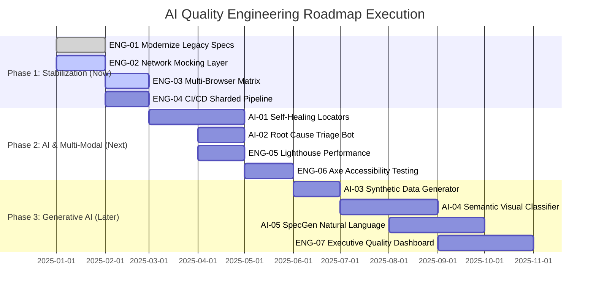

# Product Roadmap: Next-Gen AI-Augmented Quality Engineering Platform

## Executive Summary & Strategic Vision

The `playwrightdemo` repository currently provides a foundational test automation architecture utilizing Playwright, TypeScript, and Allure. While it demonstrates solid modern patterns—such as Page Object Model (POM) abstraction, visual regression testing with deterministic rendering controls, and basic REST API validation—it operates primarily as an isolated, static demonstration suite reliant on external demo environments.

As **Senior Product Manager for AI**, the strategic goal is to transform this framework from a standard test runner into an **Enterprise-Grade AI-Augmented Quality Engineering (QE) Platform**. By integrating autonomous locator self-healing, generative synthetic test data pipelines, intelligent multi-modal visual anomaly detection, automated root-cause analysis (RCA), and continuous performance/accessibility auditing, the platform will dramatically reduce test maintenance overhead, accelerate release cycles, and deliver actionable quality intelligence to engineering teams.

---

## Current State Assessment

### Strengths
- **Robust Visual Regression Foundation**: Advanced visual stabilization mechanisms in `BasePage.ts` (relayout forced on form controls, web font readiness, scroll-and-settle mechanics, CSS injection via `hide-dynamic.css`).
- **Clean Architectural Abstractions**: Use of modern Playwright test extensions (`fixtures/pageFixtures.ts`) and centralized test data (`test-data/resumeData.ts`).
- **Reporting Infrastructure**: Native integration of HTML, Line, and Allure reporting (`allure-playwright`).
- **Modern Tooling Stack**: Up-to-date core dependencies (`@playwright/test` v1.64.1, Node.js 24.x compatibility).

### Weaknesses & Operational Gaps
- **High Fragility & External Coupling**: Direct reliance on third-party public endpoints (`reqres.in`, `automationintesting.online`) without network mocking, contract tests, or failure retries on rate limits.
- **Incomplete Test Modernization**: Legacy tests (`tests/get.spec.ts` and `tests/takescreenshot.spec.ts`) bypass the Page Object Model and fixture injection patterns.
- **Underutilized Dependencies**: Performance testing libraries (`lighthouse`, `playwright-lighthouse`) are present in `package.json` but have zero active implementation in the test suites.
- **Limited Cross-Browser & Multi-Device Execution**: Playwright configuration restricts execution exclusively to Desktop Chromium, leaving Firefox, WebKit, and mobile viewport matrix unexercised.
- **Manual CI Pipeline**: CI workflow (`.github/workflows/playwright.yml`) is limited to `workflow_dispatch` without automated trigger on pull requests, push events, or scheduled regression cron runs.
- **Absence of Autonomous/AI Capabilities**: Zero intelligent failure analysis, selector self-healing, automated test generation, or dynamic visual diff classification.

---

## Strategic Themes & Value Drivers



1. **Autonomous Resilience & Self-Healing**: Eliminating flakiness and maintenance burden caused by shifting DOM trees through intelligent locator adaptation.
2. **Generative Intelligence & Synthetic Testing**: Generating realistic boundary datasets and conversational UI testing flows via generative models.
3. **Multi-Dimensional Quality**: Expanding beyond functional assertions into web accessibility (WCAG 2.1 AA), Core Web Vitals, and UX performance.
4. **Actionable Observability & Fast Feedback**: Providing developers with instant root-cause diagnostics, PR failure summaries, and zero-touch visual triage.

---

## Prioritized Task Catalog

### Estimation Scale Guide
- **Story Points (SP)**: Standard Fibonacci sequence (1, 2, 3, 5, 8, 13) reflecting complexity, uncertainty, and cognitive overhead.
- **Hours (h)**: Realistic engineering hours for full end-to-end execution (Dev Hours: architecture, coding, documentation; Test Hours: unit/integration testing, verification, edge-case validation).
- **Priority**:
  - **P0**: Mission-critical foundational capabilities; prerequisites for scale.
  - **P1**: High-value strategic features delivering immediate competitive and operational advantages.
  - **P2**: Medium-value optimizations and advanced capabilities.
  - **P3**: Exploratory, long-term speculative innovations.

---

### Master Task Inventory

| Task ID | Task Title | Priority | Dev Effort (SP / Hours) | Test Effort (SP / Hours) | Target Phase |
| :--- | :--- | :---: | :---: | :---: | :---: |
| **ENG-01** | Modernize Legacy Specs to POM & Fixture Standards | **P0** | 3 SP / 12h | 2 SP / 8h | Phase 1 (Now) |
| **ENG-02** | Network Mocking & Deterministic API Isolation Layer | **P0** | 5 SP / 20h | 3 SP / 12h | Phase 1 (Now) |
| **ENG-03** | Multi-Browser & Responsive Device Matrix Expansion | **P0** | 2 SP / 8h | 2 SP / 8h | Phase 1 (Now) |
| **ENG-04** | Automated CI/CD Pipeline with Matrix Testing & Reporting | **P0** | 3 SP / 12h | 2 SP / 8h | Phase 1 (Now) |
| **AI-01**  | Autonomous Self-Healing Locator Engine via LLM Fallbacks | **P1** | 8 SP / 32h | 5 SP / 20h | Phase 2 (Next) |
| **AI-02**  | Automated Root-Cause Triage & PR Comment Failure Bot | **P1** | 5 SP / 20h | 3 SP / 12h | Phase 2 (Next) |
| **ENG-05** | Automated Core Web Vitals & Lighthouse Performance Pipeline | **P1** | 3 SP / 14h | 2 SP / 8h | Phase 2 (Next) |
| **ENG-06** | Automated Axe-Core WCAG Accessibility Auditing Suite | **P1** | 3 SP / 12h | 2 SP / 8h | Phase 2 (Next) |
| **AI-03**  | Generative Synthetic Test Data Engine with JSON Schema Validation | **P2** | 5 SP / 20h | 3 SP / 12h | Phase 3 (Later) |
| **AI-04**  | Computer-Vision & Semantic Visual Difference Classifier | **P2** | 8 SP / 32h | 5 SP / 20h | Phase 3 (Later) |
| **AI-05**  | SpecGen: Natural Language User Story to Playwright Spec Compiler | **P3** | 13 SP / 52h | 8 SP / 32h | Phase 3 (Later) |
| **ENG-07** | Unified Executive Quality & Flakiness Trend Dashboard | **P3** | 5 SP / 20h | 3 SP / 12h | Phase 3 (Later) |

---

## Detailed Task Specifications

### Phase 1: Operational Stabilization & Core Architecture (Now)

#### ENG-01: Modernize Legacy Specs to POM & Fixture Standards
- **Description**: Refactor existing ad-hoc test scripts (`tests/get.spec.ts` and `tests/takescreenshot.spec.ts`) to conform with the repository's established Page Object Model pattern. Introduce dedicated API controller classes (`BookingApiClient`, `UserApiClient`) and extend `fixtures/pageFixtures.ts` to supply typed API fixtures. Eliminate hard-coded credentials and strings by parameterizing environment variables.
- **Priority**: P0 (High Impact / High Feasibility)
- **Dev Effort**: 3 Story Points (12 Hours)
- **Testing Effort**: 2 Story Points (8 Hours)
- **Success Criteria**:
  - Zero raw `page.goto` or unencapsulated locators in test specs.
  - 100% adherence to `test.extend` fixture patterns.
  - Backward compatibility confirmed with existing Allure reporting.

#### ENG-02: Network Mocking & Deterministic API Isolation Layer
- **Description**: Decouple the test framework from unreliable third-party public endpoints (`reqres.in`, `automationintesting.online`) by implementing Playwright network routing handlers (`page.route()`) and HAR playback or Mock Service Worker (MSW). Support running in two distinct modes: `live` (contract validation against staging) and `isolated` (mocked, ultra-fast, zero external flakiness for CI PR gates).
- **Priority**: P0 (High Impact / High Feasibility)
- **Dev Effort**: 5 Story Points (20 Hours)
- **Testing Effort**: 3 Story Points (12 Hours)
- **Success Criteria**:
  - Full suite runs offline with 0% network flakiness.
  - Ability to simulate 429 Rate Limited, 500 Internal Error, and latency spikes deterministically.

#### ENG-03: Multi-Browser & Responsive Device Matrix Expansion
- **Description**: Expand `playwright.config.ts` from Chromium-only to support Desktop Firefox, WebKit (Safari), and mobile emulations (Pixel 7, iPhone 14 Pro). Establish per-browser visual regression snapshot management and ensure cross-browser baseline generation rules are documented and containerized via Docker.
- **Priority**: P0 (High Impact / High Feasibility)
- **Dev Effort**: 2 Story Points (8 Hours)
- **Testing Effort**: 2 Story Points (8 Hours)
- **Success Criteria**:
  - Clean test execution across Chromium, Firefox, and WebKit locally and in headless CI.
  - Mobile responsive layouts verified on multiple breakpoints.

#### ENG-04: Automated CI/CD Pipeline with Matrix Testing & Reporting
- **Description**: Overhaul `.github/workflows/playwright.yml` to trigger on Pull Requests and pushes to `main`. Implement parallel test matrix sharding (`--shard=x/y`), artifact caching for Playwright browsers, automated Allure history preservation, and instant GitHub summary reports with embedded failure traces.
- **Priority**: P0 (High Impact / High Feasibility)
- **Dev Effort**: 3 Story Points (12 Hours)
- **Testing Effort**: 2 Story Points (8 Hours)
- **Success Criteria**:
  - CI execution time reduced by >40% through sharding and caching.
  - PR checks block merges on regression failures with downloadable traces.

---

### Phase 2: AI-Powered Autonomous Resilience & Multi-Modal Auditing (Next)

#### AI-01: Autonomous Self-Healing Locator Engine via LLM Fallbacks
- **Description**: Build a custom Playwright locator wrapper/fixture that catches `TimeoutError: locator.click: Timeout exceeded` or selector miss events. When a selector fails, the engine captures the local DOM subtree, sends it along with semantic intent (e.g., "Submit button on contact form") to a lightweight LLM (e.g., Claude 3.5 Haiku or OpenAI GPT-4o-mini), generates candidate replacement selectors, evaluates them for uniqueness, continues test execution, and logs a patch suggestion for the developer.
- **Priority**: P1 (High Impact / Medium Feasibility)
- **Dev Effort**: 8 Story Points (32 Hours)
- **Testing Effort**: 5 Story Points (20 Hours)
- **Success Criteria**:
  - Automatically heals modified element IDs/classes in at least 85% of simulated UI layout breakages.
  - Produces structured git diff or JSON patch suggesting permanent locator fixes.

#### AI-02: Automated Root-Cause Triage & PR Comment Failure Bot
- **Description**: Implement a GitHub Action and Playwright custom reporter plugin that monitors failed tests. On failure, the plugin aggregates the error message, Playwright trace snippet, console logs, network payloads, and DOM snapshot, prompting an LLM to generate a human-readable 3-bullet triage summary: 1) What broke, 2) Root cause hypothesis (Network, Code Defect, Environmental, or Locator), and 3) Recommended fix. Posts the summary directly as a PR comment.
- **Priority**: P1 (High Impact / High Feasibility)
- **Dev Effort**: 5 Story Points (20 Hours)
- **Testing Effort**: 3 Story Points (12 Hours)
- **Success Criteria**:
  - Reduces Mean Time to Detect/Diagnose (MTTD) test failures by over 50%.
  - Accurate categorization of flakiness vs. legitimate application regression.

#### ENG-05: Automated Core Web Vitals & Lighthouse Performance Pipeline
- **Description**: Operationalize the dormant `lighthouse` and `playwright-lighthouse` dependencies. Create automated performance regression assertions verifying Largest Contentful Paint (LCP), Cumulative Layout Shift (CLS), First Input Delay (FID), and Total Blocking Time (TBT) across key site pages (`BasePage` / `ResumePage`), asserting against strict performance budgets.
- **Priority**: P1 (High Impact / High Feasibility)
- **Dev Effort**: 3 Story Points (14 Hours)
- **Testing Effort**: 2 Story Points (8 Hours)
- **Success Criteria**:
  - Dedicated `@performance` test suite generating Lighthouse JSON/HTML audit reports.
  - Performance regressions trigger CI warnings or failures when metrics drop below 90.

#### ENG-06: Automated Axe-Core WCAG Accessibility Auditing Suite
- **Description**: Integrate `@axe-core/playwright` to conduct automated accessibility audits against WCAG 2.1 Level AA criteria. Implement page-level and component-level accessibility scans within `BasePage`, validating color contrast, ARIA landmarks, form labels, and focus order across all routes.
- **Priority**: P1 (High Impact / High Feasibility)
- **Dev Effort**: 3 Story Points (12 Hours)
- **Testing Effort**: 2 Story Points (8 Hours)
- **Success Criteria**:
  - Zero critical or serious accessibility violations reported across tested pages.
  - Formatted accessibility violations exported to Allure test reports.

---

### Phase 3: Generative Innovation & Predictive Intelligence (Later)

#### AI-03: Generative Synthetic Test Data Engine with JSON Schema Validation
- **Description**: Develop an intelligent test data generator capable of synthesizing contextually valid, edge-case, and adversarial payloads for API testing. Utilizing generative models and JSON Schema definitions, dynamically generate corner cases (e.g., Unicode boundary tests, SQLi injection payloads, boundary email formats, localized phone numbers) to validate API resiliency without hardcoding static mock files.
- **Priority**: P2 (Medium Impact / Medium Feasibility)
- **Dev Effort**: 5 Story Points (20 Hours)
- **Testing Effort**: 3 Story Points (12 Hours)
- **Success Criteria**:
  - Dynamic generation of 1,000+ distinct schema-compliant edge case payloads in <10s.
  - Automated discovery of unhandled 500 error boundary conditions in API test suites.

#### AI-04: Computer-Vision & Semantic Visual Difference Classifier
- **Description**: Enhance Playwright's pixel-based visual regression comparison (`toHaveScreenshot`) with a multi-modal computer vision / LLM classifier. When visual diffs occur, determine whether the diff represents an intentional layout change, a cosmetic font rendering variance (benign), or a genuine UI bug (broken element overlap, missing image, text truncation). Automatically approve non-breaking rendering shifts while flagging severe visual defects.
- **Priority**: P2 (High Impact / Medium Feasibility)
- **Dev Effort**: 8 Story Points (32 Hours)
- **Testing Effort**: 5 Story Points (20 Hours)
- **Success Criteria**:
  - 80% decrease in false-positive visual regression alerts caused by sub-pixel rendering or platform-specific font variations.
  - Automatic semantic diff annotation explaining visual discrepancies.

#### AI-05: SpecGen: Natural Language User Story to Playwright Spec Compiler
- **Description**: Create a CLI agent tool that takes a Jira user story, Gherkin scenario, or plain English workflow description, crawls the target web application DOM, and automatically synthesizes a fully typed, POM-compliant Playwright test spec with appropriate locators, assertions, and test hooks.
- **Priority**: P3 (High Impact / Complex Feasibility)
- **Dev Effort**: 13 Story Points (52 Hours)
- **Testing Effort**: 8 Story Points (32 Hours)
- **Success Criteria**:
  - Accelerates test authoring velocity by 60% for new feature workflows.
  - Generated code passes ESLint, TypeScript strict compilation, and executes cleanly.

#### ENG-07: Unified Executive Quality & Flakiness Trend Dashboard
- **Description**: Aggregate test results, visual diff history, accessibility compliance scores, and performance benchmarks over time into a centralized dashboard (hosted via GitHub Pages or Datadog/Grafana integration). Provide flaky test heatmaps, test duration trends, and pass-rate health metrics for leadership visibility.
- **Priority**: P3 (Medium Impact / High Feasibility)
- **Dev Effort**: 5 Story Points (20 Hours)
- **Testing Effort**: 3 Story Points (12 Hours)
- **Success Criteria**:
  - Single-pane-of-glass executive report updated on every CI execution.
  - Automated detection and flagging of flaky tests exhibiting intermittent pass/fail patterns.

---

## Strategic Phasing & Timeline



---

## Impact vs. Feasibility Matrix

```
       HIGH IMPACT
            ▲
            │   [AI-01: Self-Healing]        [ENG-02: Mocking Layer]
            │   [AI-04: Visual Classifier]   [AI-02: Root Cause Bot]
            │   [AI-05: SpecGen]             [ENG-04: CI/CD Pipeline]
            │                                [ENG-01: POM Modernization]
            │                                [ENG-05: Lighthouse Audits]
            │                                [ENG-06: A11y Suite]
            │
            │   [ENG-07: Exec Dashboard]     [ENG-03: Multi-Browser]
            │   [AI-03: Synthetic Data]
            │
            └────────────────────────────────────────────────────────►
          LOW FEASIBILITY (Complex)                   HIGH FEASIBILITY (Direct)
```

---

## Business Value & Return on Investment (ROI)

| Value Driver | Traditional Playwright Suite | AI-Augmented Platform Target | Business Impact |
| :--- | :--- | :--- | :--- |
| **Test Flakiness & Maintenance** | 15% - 25% weekly maintenance overhead due to selector shifts | < 3% maintenance overhead via AI Self-Healing | **~80% reduction in QE maintenance hours** |
| **Failure Triage Duration** | 20 - 45 mins per failure manually reviewing logs/traces | < 2 mins automated AI triage summary in PR comments | **90% acceleration in developer debugging time** |
| **Test Authoring Velocity** | 4 - 8 hours per complete multi-page flow | 1 - 2 hours leveraging SpecGen & POM generators | **3x faster time-to-market for test coverage** |
| **Quality Coverage Scope** | Functional UI and basic API endpoints only | Multi-modal: Functional, Visual, Performance, A11y, Security | **Zero critical regressions escaping to production** |

---

## Governance, Safety & Risk Mitigation

1. **LLM Cost & Latency Control**: Self-healing and triage features will invoke lightweight, cached LLM models only upon test failure, ensuring zero latency overhead during normal green test runs and negligible token cost.
2. **Deterministic Fallbacks**: Self-healed selectors will not silently mutate codebase files without explicit developer code review and PR approval.
3. **Data Privacy**: No proprietary user data or credentials will ever be passed to public LLM endpoints; local mock data and synthetic schemas will ensure complete data hygiene.
