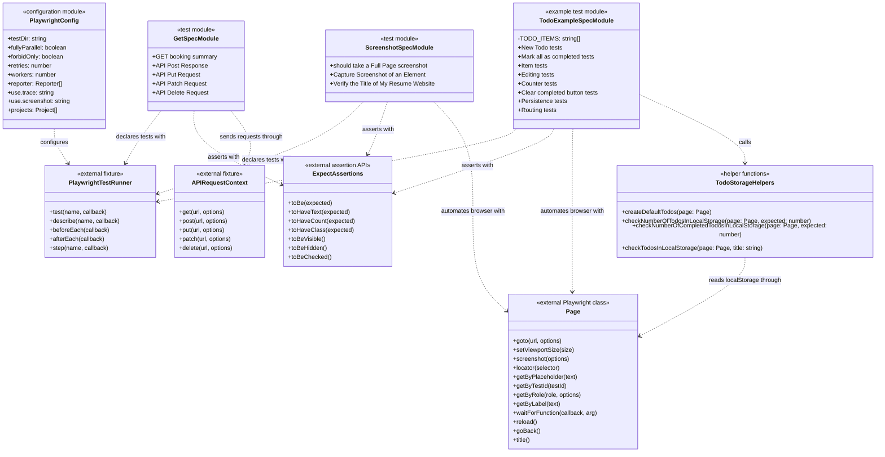

# Class and Module Architecture

## Overview

The project does not define custom TypeScript classes. It is organized around Playwright Test modules that import Playwright fixtures (`test`, `expect`, and `Page`) and declare test cases plus a few helper functions.

The UML diagram below documents the effective module-level architecture and dependencies, including Playwright-provided classes/fixtures and local helper functions used by the example TodoMVC suite.

## UML Diagram

## Module Details

### `playwright.config.ts`

Defines the Playwright Test runner configuration. It sets the primary test directory to `./tests`, enables fully parallel execution, configures CI-specific retries and workers, enables tracing on first retry, captures screenshots only on failure, and runs tests in a Chromium/Desktop Chrome project.

### `tests/get.spec.ts`

Contains API-focused Playwright tests that use the `request` fixture to exercise external REST endpoints. The module validates HTTP status codes and selected response fields for GET, POST, PUT, PATCH, and DELETE requests.

### `tests/takescreenshot.spec.ts`

Contains UI and screenshot tests using the `page` fixture. The module navigates to external web pages, sets browser viewport dimensions, captures full-page and element screenshots, and verifies a page title.

### `tests-examples/demo-todo-app.spec.ts`

Contains Playwright's TodoMVC example suite. It uses the `Page` type, Playwright locators, test hooks, nested `describe` blocks, and helper functions to validate TodoMVC behavior and `localStorage` persistence.

## Custom Classes

No repository-defined classes are currently present. If production application code or page-object models are introduced later, this document should be updated to include each class, attributes, methods, inheritance, composition, and dependencies.
