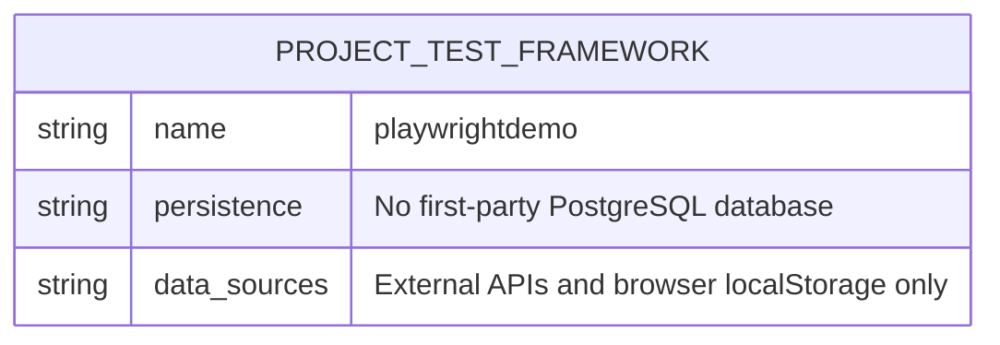

# Database Architecture

## Overview

This repository does not currently contain a first-party application database schema, database migrations, ORM models, seed data, or database connection configuration. No PostgreSQL DDL files, migration folders, or schema definitions are present in the codebase.

Because the project is an automated testing framework, its persistent data interactions are limited to browser `localStorage` in the example TodoMVC test suite and generated test report artifacts. The API tests target external public services and do not persist data in a database owned by this repository.

## PostgreSQL Schema Status

No PostgreSQL schema is defined by this project.

```sql
-- No first-party PostgreSQL schema exists in this repository.
```

## Entity-Relationship Diagram

The ERD below intentionally shows the current absence of database entities. If a PostgreSQL schema is added later, replace this placeholder with entities, primary keys, foreign keys, and cardinalities.



## Tables

No first-party database tables are defined.

| Table | Description | Fields |
| --- | --- | --- |
| _None_ | The repository does not include PostgreSQL tables. | _Not applicable_ |

## Field Descriptions

No table fields are available because no database schema is present.

## Indexes

No PostgreSQL indexes are defined in this repository.

| Index | Table | Columns | Description |
| --- | --- | --- | --- |
| _None_ | _None_ | _None_ | No database indexes are present. |

## Related Runtime Storage

Although there is no PostgreSQL database, the example TodoMVC tests assert data saved by the external demo application in browser `localStorage` under the `react-todos` key. That storage belongs to the external TodoMVC application, not this repository.
